<!--
╔══════════════════════════════════════════════════════════════════════════════╗
║                    MUHAMMAD MUBASHAR (PASHA DEV)                             ║
║             AI SYSTEMS ARCHITECT • FULL-STACK & 3D TECHNOLOGIST              ║
║                 Lahore, Pakistan • 31.5204° N, 74.3587° E                    ║
║                                                                              ║
║  Live Telemetry synced via GitHub Actions CI/CD every 6 hours               ║
╚══════════════════════════════════════════════════════════════════════════════╝
-->

<a href="https://pasha-portfolio-v6.netlify.app/">
  
</a>

  
  
  
  
  

<!-- ═══════════════════════ 01 ABOUT ═══════════════════════ -->
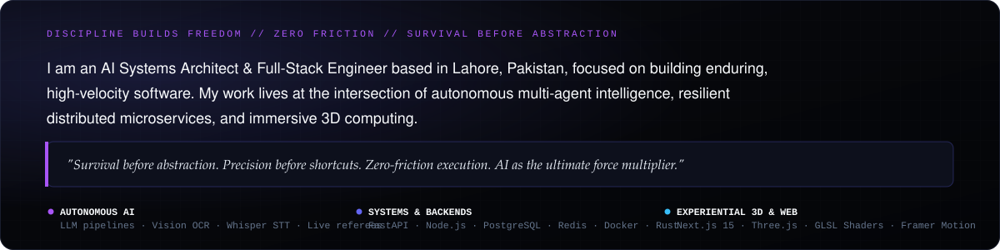

<!-- ═══════════════════════ 02 PROOF & HIGHLIGHTS ═══════════════════════ -->
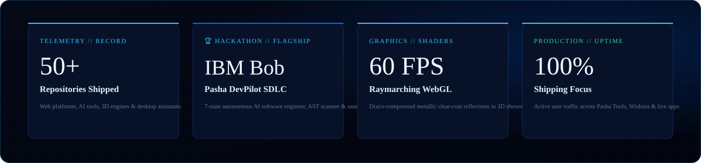

<!-- ═══════════════════════ 03 SELECTED WORK ═══════════════════════ -->

<!-- Project 1: Pasha DevPilot (IBM Bob 2.0 Hackathon Flagship) -->
<a href="https://github.com/pasha804/pasha-devpilot">
  
</a>

  
  
  

<!-- Project 2: SyncForge -->
<a href="https://github.com/pasha804/Real-Time-Collaborative-Code-Snippet">
  
</a>

  
  
  

<!-- Project 3: PrivateDoc -->
<a href="https://github.com/pasha804/Private_DOC">
  
</a>

  
  
  

<!-- Project 4: GhostReview -->
<a href="https://github.com/pasha804/gost-review-github">
  
</a>

  
  
  

<!-- Project 5: OpenCluely -->
<a href="https://github.com/pasha804/OpenCluely">
  
</a>

  
  

<!-- Project 6: BMW 7-Series 3D Experience -->
<a href="https://github.com/pasha804/bmw-7-series-3d-experience">
  
</a>

  
  

<!-- Project 7: Nexora -->
<a href="https://github.com/pasha804/NEXORA">
  
</a>

  
  

<!-- ═══════════════════════ 04 TOOLKIT ═══════════════════════ -->
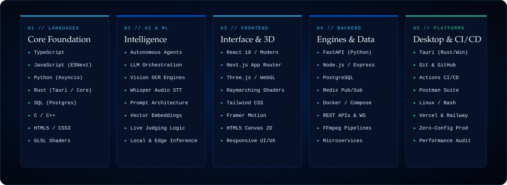

<!-- ═══════════════════════ 05 COMMIT LOG & TELEMETRY ═══════════════════════ -->

<table width="100%">
  <tr>
    <td width="50%" valign="top">
      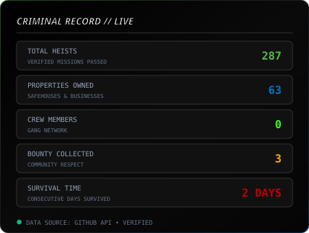
    </td>
    <td width="50%" valign="top">
      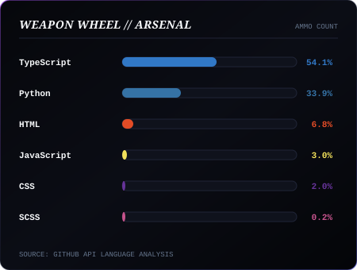
    </td>
  </tr>
</table>

 

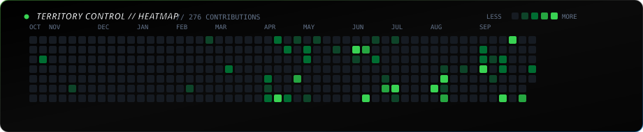

<!-- ═══════════════════════ 06 SYSTEM ARCHITECTURE ═══════════════════════ -->

<!-- ═══════════════════════ 07 CONNECT & FOOTER ═══════════════════════ -->

  
  
  
  
  

<a href="https://pasha-portfolio-v6.netlify.app/">
  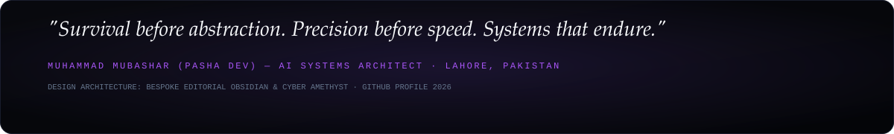
</a>
